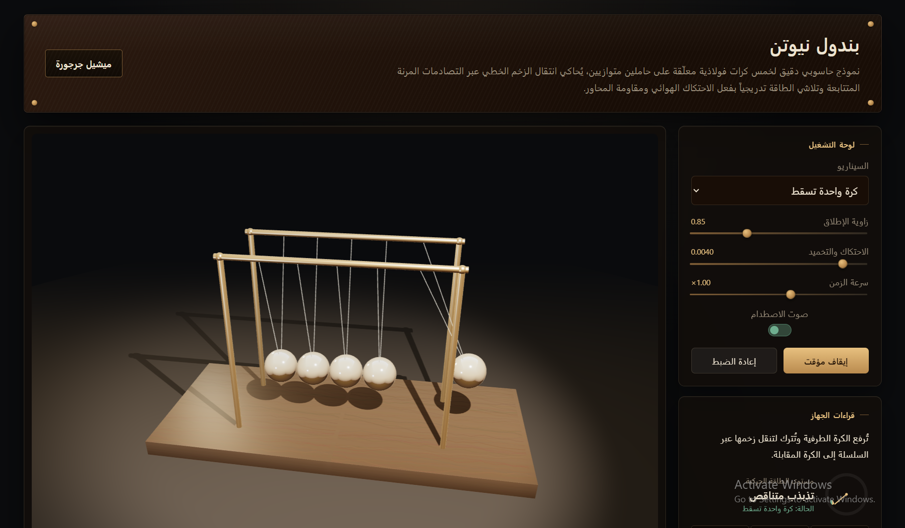

# Newton's Cradle Simulation (بندول نيوتن)

A physically-based Newton's Cradle simulation built with **Three.js**, featuring realistic elastic collisions, viscous damping, and layered Web Audio synthesis for collision sound — all wrapped in a museum-instrument-styled UI (Arabic, RTL).


##




## Demo Features

- 6 preset scenarios (single/double/triple drop, symmetric collision, gapped balls, mixed masses)
- Real-time controls: launch amplitude, damping, time speed, sound toggle
- Live energy gauge and collision tally
- Orbit camera (drag to rotate, scroll to zoom)
- Procedural collision sound (no audio assets — pure Web Audio synthesis)

## Project Structure

```
newton_pendulum/
├── index.html            # Markup + control panel + Three.js import map
├── css/
│   └── styles.css        # Museum-plaque / brass-instrument visual theme
└── js/
    ├── main.js            # Entry point — wires modules together, runs the render loop
    ├── physics.js         # Pendulum dynamics, collisions, scenario presets
    ├── sceneSetup.js       # Three.js scene: camera, lights, materials, frame, balls, strings
    ├── sound.js            # Procedural collision sound synthesis (Web Audio API)
    ├── ui.js               # DOM bindings: sliders, buttons, gauge, tally readout
    ├── cameraControls.js  # Custom orbit camera (pointer drag + wheel zoom)
    ├── studioEnv.js        # Procedural cube-map environment for reflections
    └── woodTexture.js      # Procedural wood-grain canvas texture for the table
```

### Module responsibilities

| Module | Owns |
|---|---|
| `physics.js` | All numerical simulation — pendulum motion, collision response, energy loss. No rendering code. |
| `sceneSetup.js` | All Three.js object construction — scene, camera, renderer, lights, materials, meshes. Exposes `syncVisuals()` to sync mesh transforms to physics state each frame. |
| `sound.js` | Self-contained Web Audio click synthesis. Exposes a single `playClick(intensity)` function. |
| `ui.js` | DOM event wiring and readout updates only — no physics or rendering logic. |
| `main.js` | Orchestration only — imports the above, runs `requestAnimationFrame` loop. |

This separation means the physics can be unit-tested independently of Three.js, and the sound/scene can each be swapped out without touching simulation logic.

## Running Locally

No build step required — it's plain ES modules loaded via an import map.

```bash
# from the project root
python3 -m http.server 8000
# then open http://localhost:8000
```

> Must be served over HTTP (not opened as a `file://` path), since ES modules require it.

## Physics Model

Each ball is modeled as an independent simple pendulum (angle `θ`, angular velocity `ω`), integrated with semi-implicit Euler across 8 sub-steps per frame for numerical stability. Collisions between adjacent balls are resolved as 1D elastic collisions along the swing direction, run for 4 passes per sub-step so momentum can propagate through multiple stationary balls within the same frame — exactly like the real device.

### Damping (التخميد)

A real Newton's Cradle loses energy continuously between collisions — air resistance and pivot friction gradually shrink the swing amplitude until it settles. This is modeled as **viscous damping**, added directly to each ball's equation of motion:

```
θ'' = -(g / L) · sin(θ)  −  c · θ'
```

- `-(g/L)·sin(θ)` — the standard pendulum restoring force (gravity pulling the ball back toward center)
- `− c·θ'` — the damping term: a braking force proportional to the ball's own angular velocity (`θ'` = `ω`)

**Implementation** (`physics.js`):

```javascript
const angAccel =
  -(state.gravity / state.length) * Math.sin(ball.theta) -
  state.damping * ball.omega;

ball.omega += angAccel * step;
ball.theta += ball.omega * step;
```

**Why this model:**

- **Proportional to velocity** — the faster a ball is moving, the stronger the brake. This is a reasonable approximation of drag at these speeds and produces a smooth exponential-style decay rather than an abrupt stop.
- **Always opposes motion** — because the term is `damping × omega` and is *subtracted*, it always points against the ball's current direction: a positive `omega` (swinging one way) gets pulled back, and a negative `omega` (swinging the other way) also gets pulled back. It never adds energy, only removes it.
- **Applied per-ball, per sub-step** — each of the 5 balls has its own `omega`, so damping acts independently on each. It's re-applied 8 times per rendered frame (once per sub-step), which is what makes the amplitude loss look continuous and smooth rather than stepped.
- **Independent of collision energy loss** — this is a *continuous* loss during free swinging. Energy lost *at the moment of impact* is handled separately via the coefficient of restitution (`state.restitution`) in the collision resolver. The two mechanisms are deliberately decoupled: one models drag, the other models inelastic contact.

**Tuning:** exposed as `state.damping` (default `0.004`, range `0.0005`–`0.03` via the UI slider). Higher values settle the pendulum faster; lower values let it swing longer before coming to rest.

### Collision Resolution

Adjacent balls collide when the distance between their positions drops to `2 × radius + gap`. On contact, a standard 1D elastic collision formula (parameterized by restitution `e` and masses `m1`, `m2`) redistributes angular velocity between the pair:

```javascript
const v1n = ((m1 - e*m2) / (m1+m2)) * v1 + ((1+e)*m2 / (m1+m2)) * v2;
const v2n = ((1+e)*m1 / (m1+m2)) * v1 + ((m2 - e*m1) / (m1+m2)) * v2;
```

Running this over 4 passes per sub-step lets momentum ripple through a chain of stationary balls within a single physics step, matching the visible "instant" transfer seen in a real cradle.

## Collision Sound

Rather than a single oscillator tone, `sound.js` layers two components per impact to approximate the timbre of steel-on-steel contact:

1. **Transient** — a short filtered noise burst (bandpass ~2.6–4 kHz, ~25ms decay) for the sharp "tick" of initial contact.
2. **Metallic ring** — two inharmonic partials (frequency ratio ~1.83, not a clean overtone) with fast exponential decay (~35–50ms), giving a brief metallic resonance rather than a sustained tone.

Impact loudness scales with `state.lastCollisionIntensity`, derived from the closing speed at the moment of collision, so harder hits sound louder.

